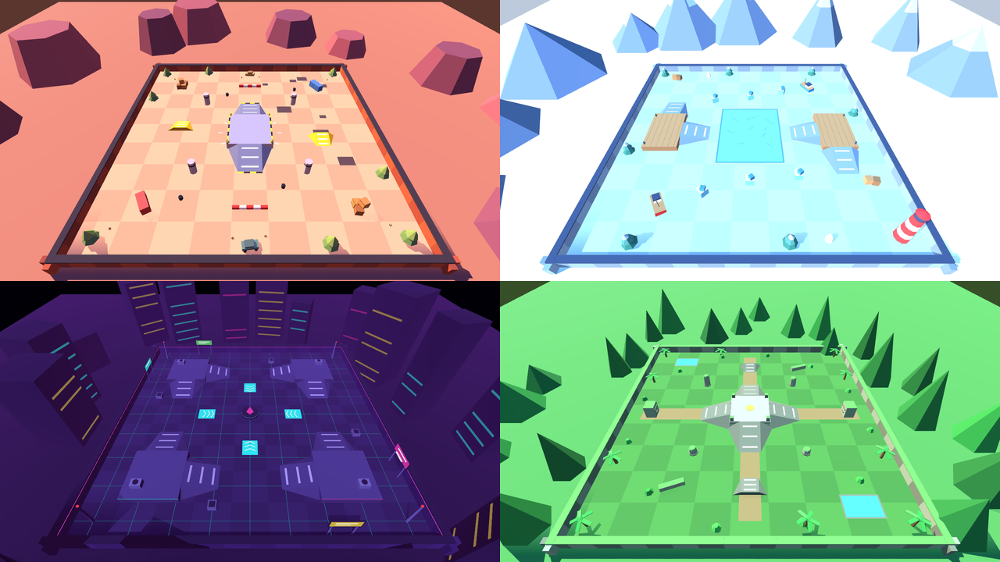
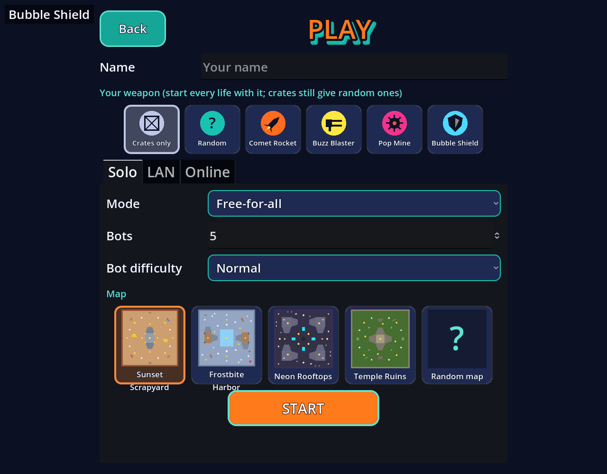
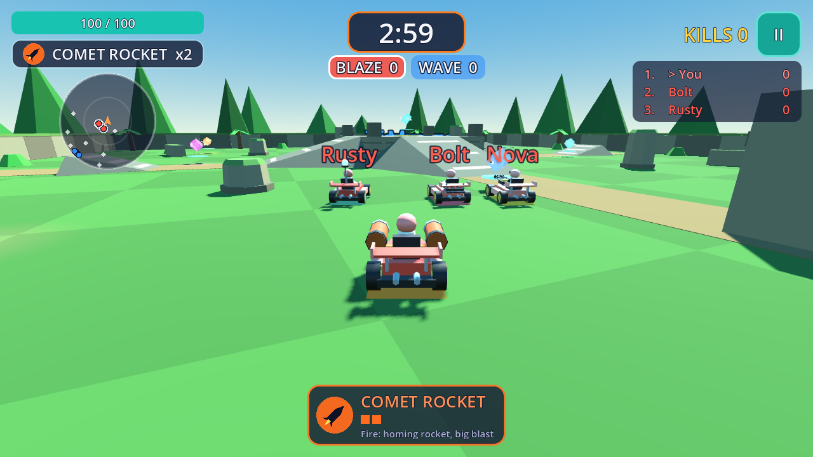
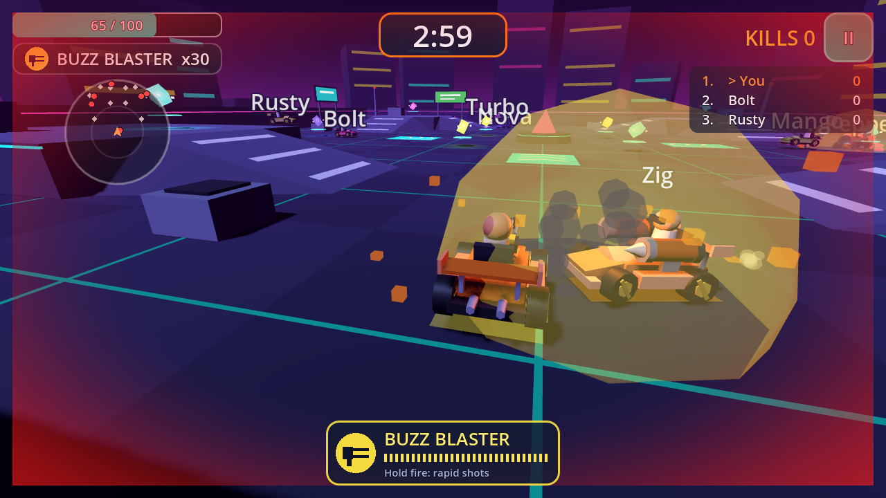
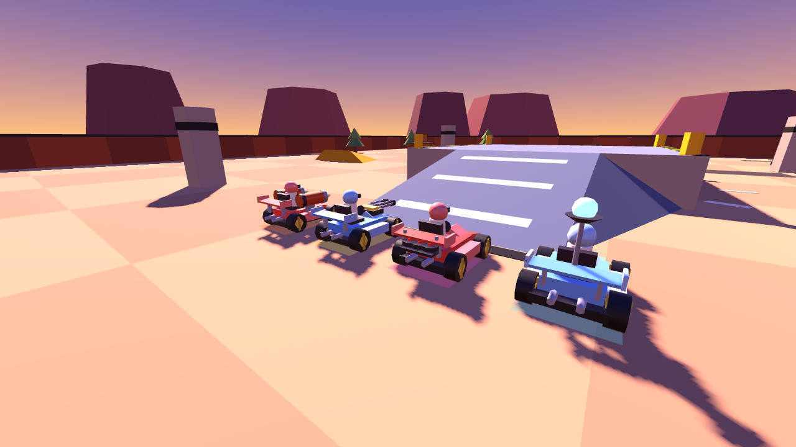

# Kart Clash

A low-poly 3D kart battle game made with **Godot 4.3 and GDScript**, inspired by the
gameplay of arena kart shooters such as Smash Karts. All models, maps, UI, music, names
and branding are original and made in code or by the scripts in this repo. There are no
third-party assets and no paid dependencies.



| Pick your weapon and map | Team Deathmatch on Temple Ruins |
|---|---|
|  |  |

| Neon Rooftops | Weapons on the kart |
|---|---|
|  |  |

## What's in it

**New in v0.3**
- **Four maps**, each with its own look, layout and music:
  - **Sunset Scrapyard**: a raised centre platform and kicker jumps.
  - **Frostbite Harbor**: a slippery frozen pond and two raised docks.
  - **Neon Rooftops**: a night map with four corner decks and boost pads.
  - **Temple Ruins**: a stepped temple with ramps on all four sides.

  Pick one, or *Random*, from preview cards that are drawn from each map's real layout.
  In multiplayer the host picks the map.
- **Choose your weapon:** pick the weapon you start every life with: one of the four, *Random*,
  or *Crates only*. You can pick it on the Play screen, in the multiplayer room, or on the
  respawn screen between lives. Crates still hand out random weapons. Bots get random
  loadouts when a player has picked one.
- **Music:** a looping track for the menu and for each map, composed and synthesised in code.
- **Gamepad support** (standard layout) next to keyboard and touch.
- **App icons and splash at full resolution** for Android, iOS and web, plus Google Play
  store graphics (see [Assets](#assets)).
- **CI:** every push runs all tests and builds the web version and an Android APK. `main` is
  published to GitHub Pages.
- **Balance:** the machine gun is a little weaker (26 rounds of 3.5 damage).

**v0.2:** LAN and online multiplayer ([docs/MULTIPLAYER.md](docs/MULTIPLAYER.md)), Team
Deathmatch (2–4 teams of up to 4), visible weapon hardware on the kart, the weapon card,
radar, hit flash, kill popups and name tags.

**v0.1:** arcade driving (drifts with boost, ramps, bumping), 1–15 AI karts, four weapons
(Comet Rocket, Buzz Blaster, Pop Mine, Bubble Shield), crates, 100 HP with knockback and
respawns, a 3-minute free-for-all, menus, settings, pause, touch controls, chase camera and
procedural sound effects.

## Controls

| Action | Keyboard | Gamepad | Touch |
|---|---|---|---|
| Accelerate | W / ↑ | RT or A | GAS |
| Brake / reverse | S / ↓ | LT or B | BRAKE |
| Steer | A D / ← → | Left stick / d-pad | Left joystick |
| Drift | Shift | LB / RB | DRIFT |
| Fire | Space | X / Y | FIRE |
| Pause | Esc / P | Start | ❚❚ button |

## Play the web version

**Hosted (after a one-time setup):** the CI workflow builds the web version on every push
to `main` and publishes it to GitHub Pages:

1. On GitHub, open the repo's **Settings → Pages**. Under *Build and deployment*, set
   **Source: GitHub Actions**. GitHub only deploys Pages from the default branch, so check
   that **Settings → General → Default branch** is `main`.
2. Push to `main` (or re-run the *CI* workflow from the **Actions** tab).
3. The game is then at **https://sahadeep125.github.io/smash-cart-game/**. It works on
   desktop and phone browsers, and on phones *Add to Home Screen* installs it like an app.

Pull requests build it too. Download the `kart-clash-web` artifact from the workflow run to
try it before merging.

**Run it yourself:**

1. Install **Godot 4.3** (standard build, not .NET) and its export templates: in the
   editor, *Editor → Manage Export Templates → Download and Install*.
2. Export:

   ```bash
   godot --headless --path . --export-release Web build/web/index.html
   ```

   Or use *Project → Export → Web → Export Project*.
3. Serve the folder over HTTP, then open http://localhost:8000:

   ```bash
   python3 -m http.server -d build/web 8000
   ```

   Opening `index.html` straight from disk won't work.
4. To publish it anywhere else (itch.io, Netlify, Cloudflare Pages, your own server),
   upload the contents of `build/web/`. The preset uses Godot's single-threaded web build,
   so no special COOP/COEP headers are needed.

The web version plays solo and online. Browsers can't do LAN games.

## Run it on desktop

1. Install **Godot 4.3** from https://godotengine.org/download. Later 4.x versions should
   also work, but 4.3 is the version it was tested with.
2. Open Godot, click **Import**, pick this folder's `project.godot`, then press **F5**.
   From a terminal you can run `godot --path .` instead.
3. **Play → Solo**: pick a weapon, a mode and a map, then press **START**.

**LAN game:**
1. On one device, open *Play → LAN → Host a LAN game*.
2. On the others, open *Play → LAN* and tap the game under "Games nearby", or type the
   host's IP.
3. The host picks the mode, map, teams and bots, then taps **START MATCH**.

To try it on one computer, run two instances (*Debug → Customize Run Instances → 2*) and
join `127.0.0.1`.

**Online game:** see [docs/MULTIPLAYER.md](docs/MULTIPLAYER.md#online-through-supabase). It's
a free, one-time Supabase setup: you paste a project URL and anon key into *Play → Online*.

## Build for Android

**Easiest:** every CI run produces a signed **debug APK**. Download it from the workflow run
(the `kart-clash-android-debug-apk` artifact), copy it to the phone and open it. You may
have to allow installs from unknown sources.

**On your own computer:**

1. **Install the tools:**
   - Godot 4.3 with its export templates (see above).
   - **JDK 17**, for example from https://adoptium.net.
   - The **Android SDK**. The simplest way is Android Studio. Then, in its *SDK Manager*,
     install *Android SDK Platform-Tools*, *Build-Tools 34* and *Platform 34*.
2. **Point Godot at them:** in the Godot editor, open *Editor → Editor Settings → Export →
   Android* and set *Java SDK Path* (the JDK folder) and *Android SDK Path*. On Windows the
   SDK is usually `%LOCALAPPDATA%\Android\Sdk`, on macOS `~/Library/Android/sdk`, and on
   Linux `~/Android/Sdk`.
3. **Debug keystore:** Godot creates one automatically the first time. If it doesn't,
   create it and point *Debug Keystore* at it (user `androiddebugkey`, password `android`):

   ```bash
   keytool -genkeypair -v -keystore debug.keystore -storepass android -alias androiddebugkey \
     -keypass android -keyalg RSA -validity 10000 -dname "CN=Android Debug,O=Android,C=US"
   ```
4. **Export:** open *Project → Export → Android → Export Project* and choose `build/android/KartClash.apk`.
   From a terminal:

   ```bash
   godot --headless --path . --export-debug Android build/android/KartClash.apk
   ```

   Or plug in a phone with USB debugging on and press the Android icon at the top right of
   the editor (*Remote Deploy*) to install and run it directly.
5. **Release / Google Play:**
   1. Create your own release keystore with `keytool`, using your own alias and password.
   2. Enter it under *Export → Android → Keystore → Release*.
   3. Set *Version Code / Name* and export with **Export With Debug** unchecked. Google Play
      wants an `.aab`: enable *Gradle Build* (*Project → Install Android Build Template*),
      set *Export Format: AAB* and export again.
   4. Store graphics are in [docs/store/](docs/store/).

The preset already has the internet, Wi-Fi and multicast permissions that multiplayer needs,
and the adaptive app icon.

## Build for iOS

iOS builds need a **Mac with Xcode** and an Apple ID. A free account can install on your own
iPhone. A paid developer account is needed for TestFlight and the App Store.

1. Install **Xcode** from the App Store, open it once, and accept the licence.
2. Install Godot 4.3 for macOS and the export templates (see above).
3. In Godot, open *Project → Export → iOS* and set:
   - **App Store Team ID**: your 10-character Team ID. Find it in Xcode under *Settings →
     Accounts* (select your team) or on developer.apple.com under *Membership*.
   - **Bundle Identifier**: change `com.kartclash.game` to something unique to you, like
     `com.yourname.kartclash`.
4. Click **Export Project** and pick an empty folder such as `build/ios/`. Godot writes an Xcode project
   (`KartClash.xcodeproj`).
5. Open the `.xcodeproj` in Xcode and:
   1. Select the target. Under *Signing & Capabilities*, tick *Automatically manage signing*
      and choose your team.
   2. Plug in your iPhone, select it as the run destination and press **Run (⌘R)**.
   3. The first time, on the phone, trust the developer certificate under *Settings →
      General → VPN & Device Management*.
6. For TestFlight or the App Store: in Xcode, choose *Product → Archive*, then *Distribute App*.

Notes:
- The 1024×1024 App Store icon and the launch-screen colour are set in the preset.
- LAN games ask for *Local Network* permission (the message is in the preset).
- LAN discovery on iOS needs Apple's multicast entitlement. Without it, join LAN games by
  typing the host's IP. Online rooms work normally.

## Test it

All tests run headless and print `PASS`/`FAIL` lines; the exit code is non-zero on failure. CI
runs the same commands.

```bash
godot --headless --path . --import                                                     # first time: build the class cache
godot --headless --path . res://tests/compile_all.tscn                                 # every script compiles
godot --headless --fixed-fps 60 --path . res://tests/map_test.tscn                    # maps, previews, bots on every map, loadouts, boost pads
godot --headless --fixed-fps 60 --path . res://tests/team_test.tscn                   # Team Deathmatch rules
GODOT=godot tests/run_net_test.sh lan                                                  # host + client processes over LAN
GODOT=godot tests/run_net_test.sh online                                               # same through a mock Supabase server (pip install websockets)
godot --headless --fixed-fps 60 --path . res://scripts/game/integration_test.tscn     # full flow: menu → match → end screen → play again
godot --headless --fixed-fps 60 --path . res://scripts/combat/combat_test.tscn        # weapons, damage, crates, death, respawn
godot --headless --fixed-fps 60 --path . res://scripts/ui/ui_test.tscn                # settings, timer, scoring, HUD, touch input
godot --headless --fixed-fps 60 --path . res://scripts/kart/kart_test_scene.tscn -- --frames=1500 --map=harbor   # driving + AI on any map
```

Headless runs print `ERROR: Parameter "m" is null` lines. These come from Godot's dummy
renderer when procedural meshes are created without a GPU and don't happen in a normal run.

## Assets

- **3D models, maps and UI** are built in code (`scripts/kart/kart_model.gd`,
  `scripts/kart/weapon_mount.gd`, `scripts/arena/*`, `scripts/ui/*`).
- **Music** (`scripts/audio/music.gd`) and **sound effects** (`scripts/combat/sfx.gd`) are
  synthesised in code at runtime.
- **App icons, splash and store art** are generated at full resolution by
  `tools/make_art.py`. Regenerate them with `pip install pillow && python3 tools/make_art.py`.
  - `assets/icons/icon.png`: 1024×1024 project, web and desktop icon.
  - `assets/icons/icon_ios_1024.png`: App Store icon (square, no alpha).
  - `assets/icons/android_adaptive_{foreground,background}.png` (432×432) and
    `android_icon_192.png`.
  - `assets/splash/splash.png`: 1920×1080 boot splash.
  - `docs/store/`: Google Play 512 icon, 1024×500 feature graphic, 1024 square promo.

  The title text uses the Inter font (SIL Open Font License).
- If you'd like hand-made models, produced music or key art, see
  [docs/ASSET_PROMPTS.md](docs/ASSET_PROMPTS.md). It has ready-to-use prompts and says where
  each file goes.

## Project layout

```
project.godot            Input map, autoloads, physics layers, renderer, icon, splash
export_presets.cfg       Web / Android / iOS presets
.github/workflows/ci.yml Tests, web + Android builds, GitHub Pages deploy
scenes/                  main_menu.tscn (main scene), lobby.tscn (Play screen), game.tscn
tests/                   compile, map, Team Deathmatch and network tests, mock Supabase server
tools/make_art.py        Generates icons, splash and store art
scripts/core/events.gd   Global signal bus (autoload "Events")
scripts/game/            game.gd composes a match; integration_test.*
scripts/kart/            Kart physics, procedural kart model, weapon mounts, player input, AI driver
scripts/arena/           ArenaBase map builder, the four maps, Maps catalog
scripts/audio/           Procedural music (autoload "Music")
scripts/camera/          Follow camera with shake
scripts/combat/          Health, weapons, loadouts, projectiles, mines, explosions, crates, respawn, SFX
scripts/systems/         Settings, GameState (timer, scores, teams), MatchSetup, Teams
scripts/net/             Net autoload (sessions, lobby), MatchSync, LAN discovery, Supabase peer
scripts/ui/              Theme, menus, Play screen, map/weapon pickers, HUD, touch controls, pause, match end
docs/                    Architecture, multiplayer, roadmap, asset prompts, screenshots, store art
```

See [docs/ARCHITECTURE.md](docs/ARCHITECTURE.md) for how the modules talk to each other and
[docs/ROADMAP.md](docs/ROADMAP.md) for the list of gaps, what's done and what's next.

Handy tuning spots:
- Weapon stats: `scripts/combat/weapon_db.gd`.
- Match length: `scripts/systems/game_state.gd` (`match_duration`).
- Driving feel: the top of `scripts/kart/kart.gd`.
- AI behaviour: `scripts/kart/ai_driver.gd`.
- Music recipes: the top of `scripts/audio/music.gd`.

## Known limitations

- **Online play hasn't been tested against a real Supabase project.** It was tested only
  against a local server that implements Supabase's published Realtime protocol. Please
  try one real room.
- **Real devices:** multiplayer was tested with game processes on one machine, not across
  phones on Wi-Fi. LAN discovery may not list games on iOS or on some Android phones; join
  by IP instead.
- **Web builds** can't host or join LAN games (browsers have no UDP), but they can play online.
- **No host migration.** If the host leaves, the match ends, and players can't join a match
  in progress.
- **Mobile builds:** the Android APK is built in CI but hasn't been run on a phone. The iOS
  build hasn't been made, because it needs macOS and Xcode.
- **Audio:** music and sound effects are generated and level-checked, but nobody has
  listened to them yet. The build machine has no audio output. Music loops are short
  (about 8 s) and take a few seconds to render the first time; they're prepared in the
  background while you're in the menu.
- **Balance and AI:** balance is still first-pass, and the AI doesn't use the kicker jumps.
