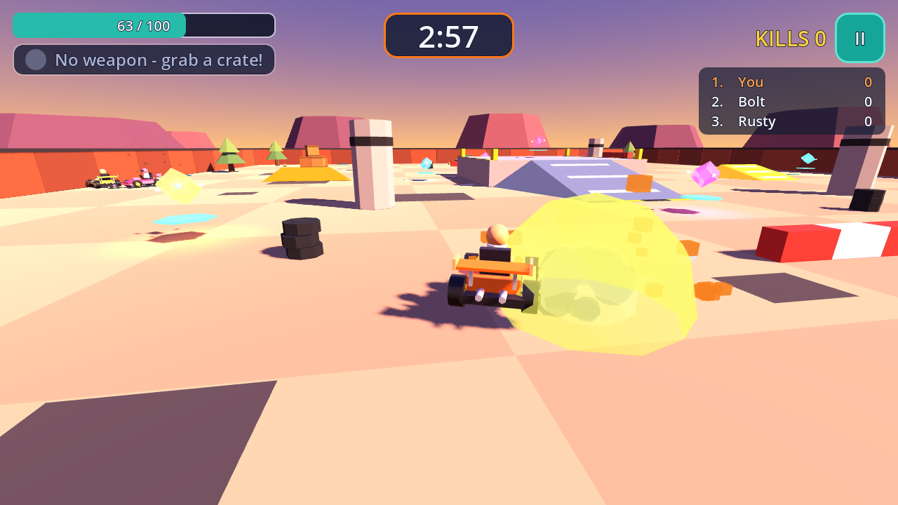
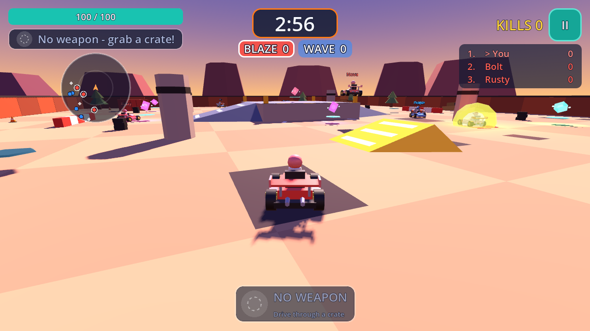

# Kart Clash

A low-poly 3D kart battle game made with **Godot 4.3 and GDScript**, inspired by the
gameplay of arena kart shooters such as Smash Karts. All models, maps, UI, names and branding
are original and built in code: there are no imported or third-party assets and no paid
dependencies.



| Weapons on the kart | Team Deathmatch |
|---|---|
|  |  |

## What's in it

**New in v0.2**
- **Multiplayer:** LAN games (host / join, games nearby are found automatically) and online
  rooms with a 5-letter code, relayed through your own free Supabase project. See
  [docs/MULTIPLAYER.md](docs/MULTIPLAYER.md).
- **Team Deathmatch:** 2–4 teams of up to 4 karts, team colours, bots fill empty seats, no
  friendly fire, team score bar and team results.
- **Weapons on the kart:** each weapon bolts visible hardware onto the kart (side rocket pods,
  twin rotary guns on the hood, a mine rack with the remaining mines, a shield emitter mast)
  plus a coloured underglow; rockets and mines disappear from the kart as you use them.
- **Weapon card:** big bottom-centre card with an icon, name, ammo pips and a usage hint; the
  touch FIRE button shows the weapon's icon and colour.
- **Polish:** radar, red hit flash, "WRECKED Bolt!" popups, "wrecked by" on the respawn
  screen, name tags over other karts, a Play screen with Solo / LAN / Online.

**From v0.1**

- **One arena**, *Sunset Scrapyard*: walled ~90 m arena with pillars, tyre stacks, low walls,
  kicker ramps and a raised centre platform reached by ramps.
- **One playable kart** plus 1–7 **AI karts** (default 5) that hunt crates, chase rivals,
  fire, avoid walls and recover when stuck.
- **Arcade driving**: acceleration, braking/reverse, speed-based steering, drifting with a
  boost on release, ramps and jumps, wall bounces and kart-to-kart bumping.
- **Weapon crates** that hand out a random weapon and respawn after 6 s.
- **Four weapons**: Comet Rocket (2 shots, light homing, explosion), Buzz Blaster
  (30-round machine gun), Pop Mine (3 proximity mines dropped behind), Bubble Shield
  (5 s invulnerability).
- **Health (100 HP), explosions with knockback, kills, 3 s respawn** with spawn protection.
- **3-minute free-for-all match** with a 3-2-1 countdown, kill feed, leaderboard and a
  match-end ranking screen (Play again / Main menu).
- **Main menu, settings** (volumes, touch controls auto/on/off, AI count, AI difficulty,
  camera shake, FPS counter; saved to `user://settings.cfg`), **pause menu**.
- **Mobile touch controls**: steering joystick on the left; Gas, Brake, Drift and Fire
  buttons on the right; multi-touch; shown automatically on touch devices.
- Chase camera with speed-based FOV, wall avoidance and explosion shake.
- Procedural sound effects (generated in code).


## Controls

| Action | Keyboard | Touch |
|---|---|---|
| Accelerate | W / ↑ | GAS |
| Brake / reverse | S / ↓ | BRAKE |
| Steer | A D / ← → | Left joystick |
| Drift | Shift | DRIFT |
| Fire | Space | FIRE |
| Pause | Esc / P | ❚❚ button |

## Run it

1. Install **Godot 4.3** (standard build, not .NET) from https://godotengine.org/download.
   Later 4.x versions should also work; 4.3 is the version it was tested with.
2. Open Godot, **Import**, select this folder's `project.godot`, then press **F5** (Run).
3. **Play → Solo** for a match against bots (Free-for-all or Team Deathmatch).

**LAN game:** on one device, *Play → LAN → Host a LAN game*; on the others, *Play → LAN* and
tap the game in "Games nearby" (or type the host's IP). The host picks the mode, teams and bots
and taps **START MATCH**. To try it on one computer, run the game twice (in the editor:
*Debug → Customize Run Instances → 2 instances*) and join `127.0.0.1`.

**Online game:** see [docs/MULTIPLAYER.md](docs/MULTIPLAYER.md#online-through-supabase) for the
one-time Supabase setup (free; you paste a project URL and anon key into *Play → Online*).

From the command line: `godot --path .` (or `godot --path . --editor` to open the editor).

## Test it

All tests run headless and print `PASS`/`FAIL` lines; exit code is non-zero on failure.

```bash
godot --headless --path . --import                                                     # first time: build the class cache
godot --headless --path . res://tests/compile_all.tscn                                 # every script compiles
godot --headless --fixed-fps 60 --path . res://tests/team_test.tscn                   # Team Deathmatch rules
GODOT=godot tests/run_net_test.sh lan                                                  # host + client processes over LAN
GODOT=godot tests/run_net_test.sh online                                               # same through a mock Supabase server (pip install websockets)
godot --headless --fixed-fps 60 --path . res://scripts/game/integration_test.tscn     # full flow: menu → match → end screen → play again
godot --headless --fixed-fps 60 --path . res://scripts/combat/combat_test.tscn        # weapons, damage, crates, death, respawn
godot --headless --fixed-fps 60 --path . res://scripts/ui/ui_test.tscn                # settings, timer, scoring, HUD, touch input
godot --headless --fixed-fps 60 --path . res://scripts/kart/kart_test_scene.tscn -- --frames=1500   # driving + AI
```

Headless runs print `ERROR: Parameter "m" is null` lines. These come from Godot's dummy
renderer when procedural meshes are created without a GPU and don't happen in a normal run.

## Export

Export presets for **Web**, **Android** and **iOS** are in `export_presets.cfg`. First install
the export templates: *Editor → Manage Export Templates → Download and Install*.

- **Web**: *Project → Export → Web → Export Project* (output `build/web/index.html`), or
  `godot --headless --path . --export-release Web build/web/index.html`.
  The preset uses the single-threaded build, so any static web host works without special
  COOP/COEP headers. Serve the folder over HTTP (for example
  `python3 -m http.server -d build/web 8000`) and open http://localhost:8000; opening the
  file directly from disk won't work.
- **Android**: install Android Studio's SDK and a JDK 17, set their paths in *Editor Settings →
  Export → Android*, create a debug keystore (Godot can generate one), then export the
  Android preset to an `.apk`, or use *Remote Debug* to run on a connected phone.
- **iOS**: needs a Mac with Xcode. Set your Apple Team ID in the iOS preset, export, then
  open the generated Xcode project, sign and run on a device.

The project uses the **Compatibility** renderer (OpenGL ES 3 / WebGL 2) on every platform
so the same project runs on the web and on older phones. Particles use `CPUParticles3D`.

## Project layout

```
project.godot            Input map, autoloads, physics layers, renderer
export_presets.cfg       Web / Android / iOS presets
scenes/                  main_menu.tscn (main scene), lobby.tscn (Play screen), game.tscn
tests/                   compile, Team Deathmatch and network tests, mock Supabase server
scripts/core/events.gd   Global signal bus (autoload "Events")
scripts/game/            game.gd composes a match; integration_test.*
scripts/kart/            Kart physics, procedural kart model, player input, AI driver
scripts/arena/           Arena geometry, obstacles, ramps, spawn and crate markers
scripts/camera/          Follow camera with shake
scripts/combat/          Health, weapons, projectiles, mines, explosions, crates, respawn, SFX
scripts/systems/         Settings, GameState (timer, scores, teams), MatchSetup, Teams
scripts/net/             Net autoload (sessions, lobby), MatchSync, LAN discovery, Supabase peer
scripts/ui/              Theme, main menu, HUD, touch controls, pause, settings, match end
docs/                    Architecture/contracts, reference analysis, screenshots
```

See [docs/ARCHITECTURE.md](docs/ARCHITECTURE.md) for how the modules talk to each other
(signal bus plus a few small, documented APIs) and
[docs/REFERENCE_ANALYSIS.md](docs/REFERENCE_ANALYSIS.md) for the short analysis of the
reference game.

Handy tuning spots: weapon stats in `scripts/combat/weapon_db.gd`, match length in
`scripts/systems/game_state.gd` (`match_duration`), driving feel at the top of
`scripts/kart/kart.gd`, AI behaviour in `scripts/kart/ai_driver.gd`.

## Known limitations

- **Online play has not been tested against a real Supabase project**: the build machine
  couldn't reach supabase.co, so it was tested against a local server that implements
  Supabase's published Realtime protocol. Please try one real room before relying on it.
- LAN multiplayer was tested with two (and online with four) game processes on one machine,
  not across real phones on Wi-Fi. LAN discovery may not list games on iOS (needs an Apple
  entitlement) or on some Android phones; joining by IP works.
- Web builds can't host or join LAN games (browsers have no UDP); they can play online.
- No host migration: if the host leaves, the match ends for everyone. Players can't join a
  match already in progress.
- Android and iOS builds have **not** been built or run on a device: the build machine had no
  Android SDK/keystore and iOS needs macOS + Xcode. Presets are included, and the game uses
  only features that work on those platforms, but treat mobile as untested.
- Touch controls were checked with injected multi-touch events in Godot and with emulated
  touch in headless Chromium, not on a physical phone.
- Performance on real phones hasn't been measured.
- Sound effects are generated in code and haven't been listened to (tests ran headless).
- Balance is first-pass: the machine gun tends to get the most kills, and the AI doesn't use
  the kicker jumps.
